<p align="center"></p>

I set up a small Microsoft Entra ID (formerly Azure Active Directory) tenant and worked through the kind of requests a help desk gets about user accounts: new hires, password resets, a department change and someone leaving. Each one is written up below as a ticket, with the steps I took and screenshots from the Entra admin center.

## Tools used

- Microsoft Entra ID (formerly Azure Active Directory), managed through the Microsoft Entra admin center
- Security groups for access management
- GitHub and Markdown for the write-up

## Tasks demonstrated

- [x] Created employee accounts (onboarding)
- [x] Created department security groups: Accounting, Sales, HR
- [x] Assigned users to their groups
- [x] Reset a user's password
- [x] Changed a user's access after a department change
- [x] Disabled an employee account (offboarding)

## Environment

- Default Directory tenant in Entra ID
- Three test users, three security groups
- All names are made up. Tenant domain, object IDs and my admin account are blurred or blacked out in the screenshots.

## Scenario

A small company called Doe & Co. is bringing on three people. I'm the IT support tech, so HR and the IT manager send me requests and I handle them in Entra.

| Employee | Department |
|---|---|
| Mike Doe | Sales |
| Jessica Doe | HR |
| Sarah Doe | Accounting |

## Tickets

| Ticket | Type | What happened |
|---|---|---|
| INC-1001 | Onboarding | Create accounts for the three new hires |
| INC-1002 | Groups | Create department security groups and add people |
| INC-1003 | Password reset | Mike can't sign in |
| INC-1004 | Access change | Sarah moves from Accounting to Sales |
| INC-1005 | Offboarding | Jessica leaves, account needs to be disabled |

---

## INC-1001: New employee accounts

<p align="center">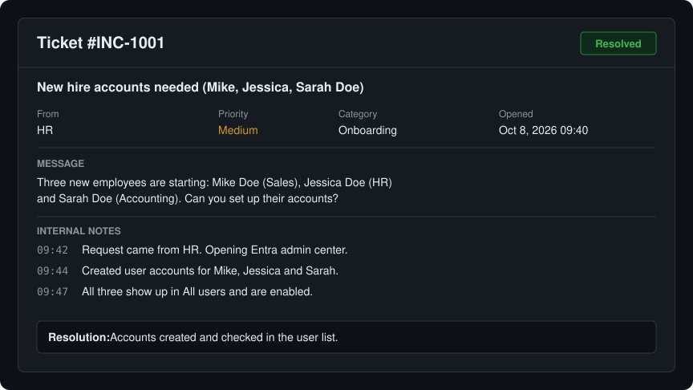</p>

What I did:

1. Signed in to the Entra admin center.
2. Went to Users > All users > New user > Create new user.
3. Filled in the user principal name, display name and a starting password for Mike, Jessica and Sarah.
4. Checked the user list to make sure all three were there.

<p align="center">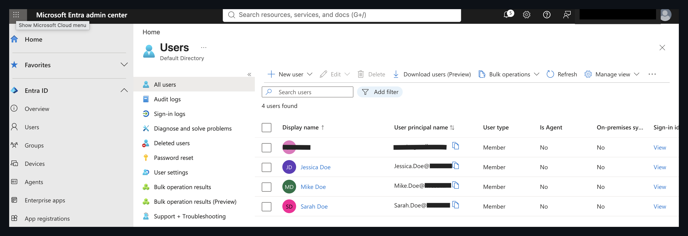</p>
<p align="center"><sub>All three accounts in the user list. The fourth entry is my admin account.</sub></p>

---

## INC-1002: Department groups

<p align="center">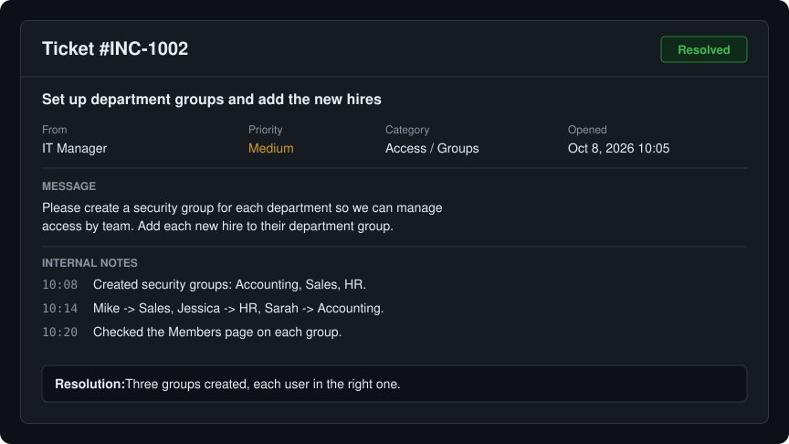</p>

What I did:

1. Went to Groups > All groups > New group.
2. Created three security groups named Accounting, Sales and HR.
3. Added Mike to Sales, Jessica to HR and Sarah to Accounting.
4. Opened the Members page of each group to confirm.

<p align="center">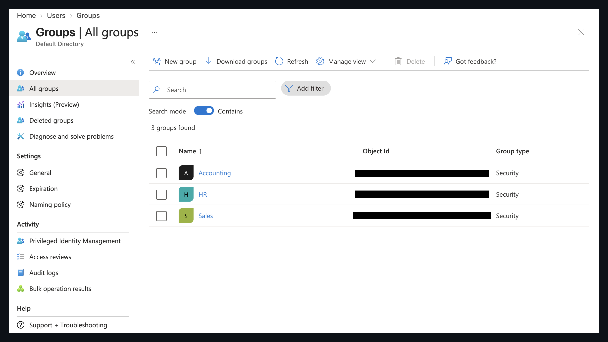</p>
<p align="center"><sub>The three groups, all type Security.</sub></p>

<p align="center">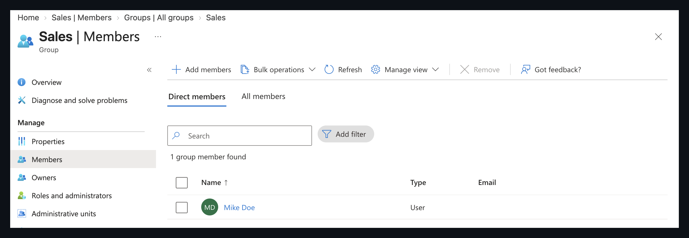</p>
<p align="center"><sub>Sales: Mike Doe</sub></p>

<p align="center">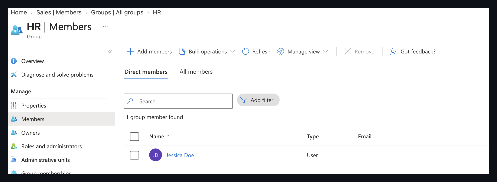</p>
<p align="center"><sub>HR: Jessica Doe</sub></p>

<p align="center">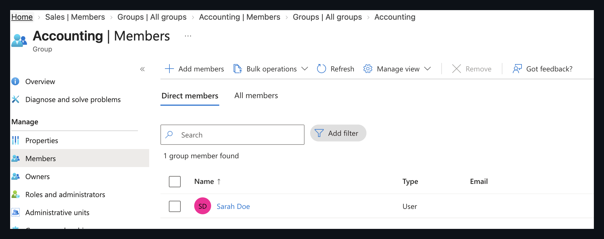</p>
<p align="center"><sub>Accounting: Sarah Doe</sub></p>

---

## INC-1003: Password reset

<p align="center">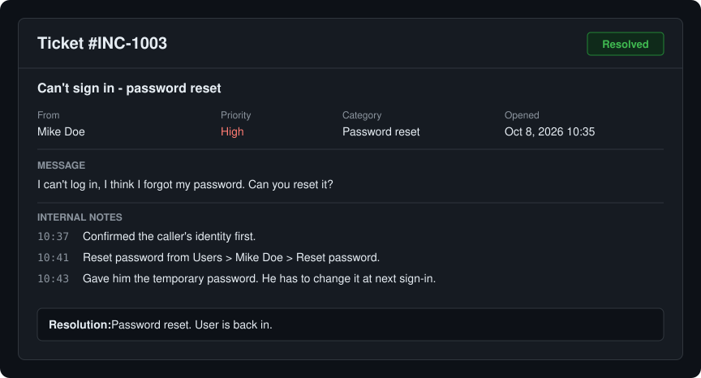</p>

What I did:

1. Confirmed who was asking before touching the account.
2. Opened Mike Doe's user page and clicked Reset password.
3. Entra generated a temporary password. He has to change it the next time he signs in.
4. Gave him the temporary password.

<p align="center">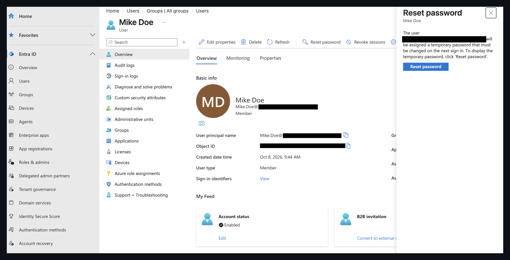</p>
<p align="center"><sub>Reset password panel. The email address is blacked out.</sub></p>

<p align="center">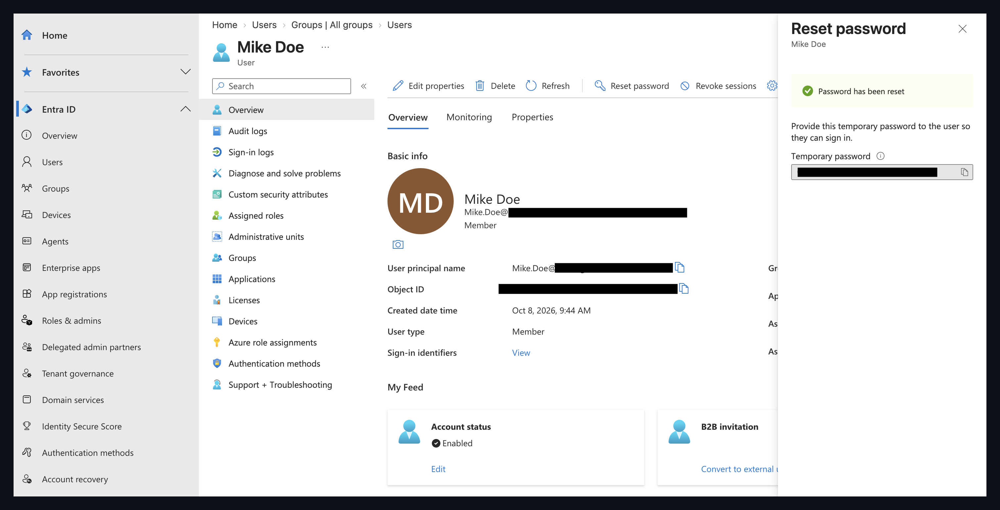</p>
<p align="center"><sub>Confirmation that the password was reset. The temporary password is hidden.</sub></p>

---

## INC-1004: Sarah moves to Sales

<p align="center">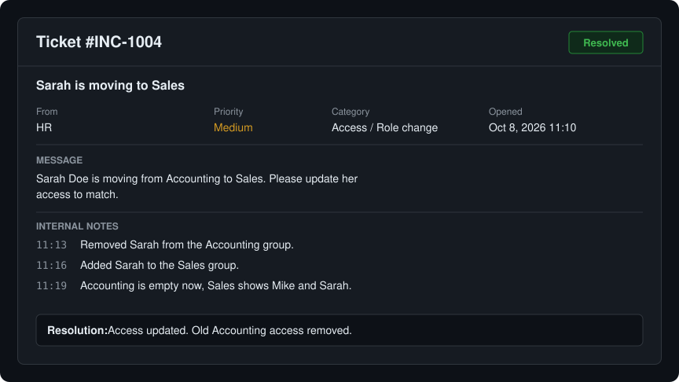</p>

What I did:

1. Opened the Accounting group and removed Sarah.
2. Opened the Sales group and added her.
3. Checked both groups. Accounting is empty and Sales has Mike and Sarah.

I removed the old access instead of just adding the new one, so she doesn't keep Accounting permissions she no longer needs.

<p align="center">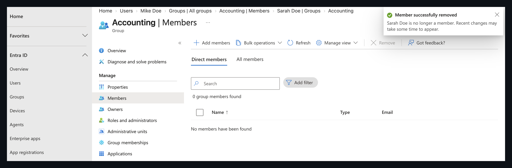</p>
<p align="center"><sub>Sarah removed from Accounting. The group has 0 members.</sub></p>

<p align="center">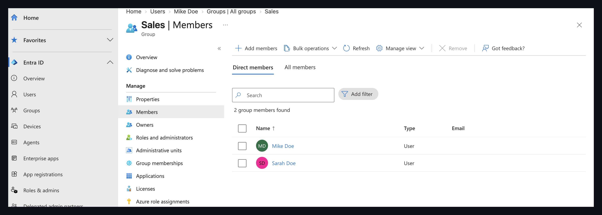</p>
<p align="center"><sub>Sales now has two members, Mike and Sarah.</sub></p>

---

## INC-1005: Jessica leaves the company

<p align="center">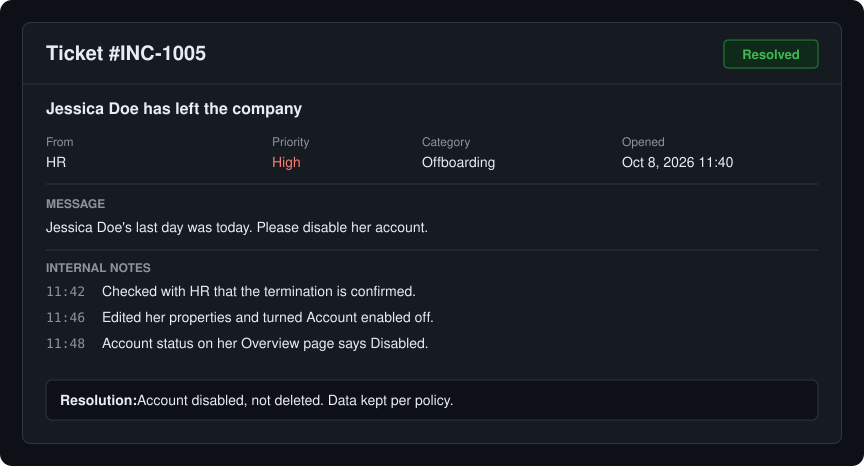</p>

What I did:

1. Opened Jessica Doe's user page and chose Edit properties.
2. Turned Account enabled off and saved.
3. Checked her Overview page. Account status says Disabled.

I disabled the account and did not delete it, so her data is still there if the company needs it.

<p align="center">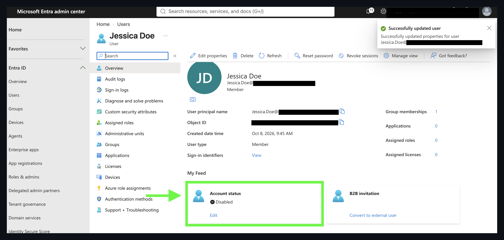</p>
<p align="center"><sub>Account status: Disabled (highlighted), plus the "Successfully updated user" message.</sub></p>

---

## Where things ended up

| User | Account | Group |
|---|---|---|
| Mike Doe | Enabled | Sales |
| Sarah Doe | Enabled | Sales |
| Jessica Doe | Disabled | HR |

Accounting has no members.

## What I learned

- Putting people in groups makes access much easier to manage than setting it per user.
- When someone changes roles, the old access has to come off, not just the new access go on.
- Disabling an account is the fast, safe first step for offboarding.
- Checking identity before a password reset matters, since that is an easy way to get social engineered.
- Writing up each ticket with notes and a resolution makes the work easy to follow later.

## Repo layout

```
README.md
assets/        ticket images (inc-1001.svg to inc-1005.svg)
screenshots/   Entra admin center screenshots
```
